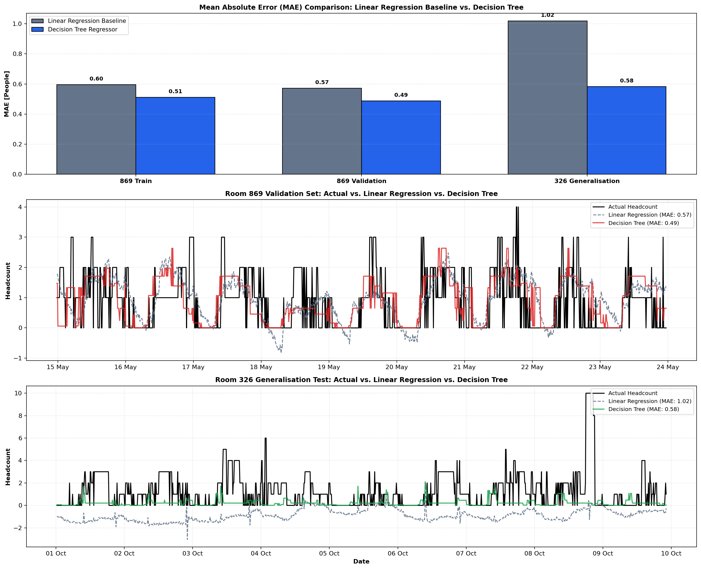

# MMA3001 - IoT Environmental Telemetry & Occupancy Prediction

An end-to-end data engineering and machine learning pipeline that predicts indoor room occupancy (headcount) from ambient environmental telemetry (CO₂, temperature, and light volatile organic compounds), benchmarked across multiple rooms and multi-year sensor deployments.

---

## 📌 Project Overview

Indoor air quality and occupancy dynamics are intrinsically linked through human metabolism: occupants continuously emit carbon dioxide ($\text{CO}_2$) and body heat. This project extracts, cleans, aligns, and models telemetry from multiple IoT sensor nodes to:
1. **Discover Physical Room Mappings**: Identify which occupancy camera shares a room with an environmental sensor using respiration physics ($\text{CO}_2$ concentration and rate-of-change correlation).
2. **Handle Asynchronous Event Alignment**: Bridge periodic environmental sensor data (recorded every 10–15 minutes) with event-driven occupancy logs (which only record when headcount changes) using chronological backward-fill (`merge_asof`).
3. **Train & Benchmark Predictive Models**: Train a **Decision Tree Regressor** on Room 869, evaluate its in-room validation performance, benchmark it against a **Linear Regression Baseline** (Topic 5.1), and test its **cross-room generalization** on unseen Room 326.

---

## 🏗️ Repository Architecture

```text
MMA3001 Project/
├── 1. Given Data/                    # Raw source telemetry (gitignored due to file size)
│   ├── 5EnvSensor_MayToDec2024_180kRows.csv       # Raw nested JSON environmental logs
│   └── 5occupancySensor_MayToDec2024_9MRows.csv   # Raw 9.09M occupancy event logs
│
├── 2. Initial data analysis/         # Exploratory analysis and visual diagnostic scripts
│   ├── generate_all_plots.py
│   ├── generate_overview_plots.py
│   └── plot_sensor_temp_co2.py
│
├── 3. Initial plots/                 # Baseline IAQ and thermal comfort visualizations
│
├── 4. Reducing data Code/            # Data engineering and preprocessing pipeline
│   ├── parse_and_clean.py                         # Flattens nested JSON telemetry to tabular CSV
│   ├── Splitting data sets validation and training.py # Active window filtering & 2/3 train-val splits
│   └── Occupancy data set creation.py             # Single-pass 9M row streaming occupancy extractor
│
├── 5. Reduced Data/                  # Prepared datasets (occupancy files gitignored)
│   ├── 5EnvSensor_Cleaned_Tabular.csv             # Full cleaned environmental dataset
│   ├── 869_train.csv / 869_validation.csv         # Room 869 active period (mid-March to mid-June 2024)
│   ├── 326_train.csv / 326_validation.csv         # Room 326 active period (Oct 2025 to end of April 2026)
│   ├── 869_occupancy.csv                          # Aligned Room 869 ground-truth occupancy
│   └── 326_occupancy.csv                          # Aligned Room 326 ground-truth occupancy
│
├── 6. Decision Tree/                 # Machine learning models and evaluation
│   ├── make decision tree model.py                # Decision tree pipeline & room matching
│   ├── Linear Regressino Model baseline.py        # Linear regression baseline vs. Decision tree
│   └── match_rooms.py                             # Correlation analysis utility
│
└── 7. Decision Tree Plots/                            # High-resolution generated model diagnostic figures
    ├── decision_tree_headcount_model.png          # Decision tree validation & generalization plot
    ├── linear_regression_vs_decision_tree.png     # Side-by-side baseline comparison plot
    └── decision_tree_optimisation_curve.png       # compares MAE for different max depth and leaf samples
```

---

## ⚙️ Data Engineering & Active Time Windows

Telemetry devices had varying operational lifecycles, battery replacements, and sensor saturation periods. The pipeline explicitly filters for clean, non-flatlined active deployments:

| Node | Physical Active Window | Duration | Notes |
| :--- | :--- | :--- | :--- |
| **Room 869** | **15 March 2024 – 14 June 2024** | **91.2 days** | Excludes flatlined 520 ppm $\text{CO}_2$ period after mid-June |
| **Room 326** | **01 October 2025 – 22 April 2026** | **203.9 days** | Excludes inactive/flatlined 525 ppm 2024 period |

### Ground-Truth Occupancy Alignment
Because camera sensors only log events when someone enters or leaves, merging on exact timestamps drops over 95% of records. The pipeline uses **`merge_asof(direction='backward')`** to hold the last observed headcount constant until the next recorded headcount change, retaining exact integer occupant counts.

Retained occupancy fields:
* `occupancystatuschangedate` (timestamp of state change)
* `id` (unique event record ID)
* `headcount` (number of people in room)
* `occupancystatus` (`CurrentlyOccupied`, `RecentlyOccupied`, `NotOccupied`)
* `floorspaceid` (unique room identifier)

---

## 🔬 Machine Learning: Decision Tree vs. Linear Regression Baseline

Models are trained strictly on **Room 869 Training Data** and evaluated on:
1. **Room 869 Training Fit** (internal fit)
2. **Room 869 Validation Set** (in-room unseen time generalization)
3. **Room 326 Test Set** (out-of-sample cross-room generalization to prove multi-room transferability)

### Comparative Performance

| Model | Evaluation Dataset | MAE [People] | RMSE [People] | $R^2$ | Key Characteristic |
| :--- | :--- | :--- | :--- | :--- | :--- |
| **Linear Regression** *(Baseline)* | Room 869 Train | 0.60 | 0.80 | +0.343 | Unconstrained continuous linear fit |
| **Decision Tree Regressor** | Room 869 Train | **0.51** | **0.75** | **+0.429** | **15% lower error** |
| **Linear Regression** *(Baseline)* | Room 869 Val | 0.57 | 0.75 | +0.176 | Predicts negative headcounts ($<0$) |
| **Decision Tree Regressor** | Room 869 Val | **0.49** | **0.71** | **+0.256** | **14% lower error; non-negative** |
| **Linear Regression** *(Baseline)* | Room 326 Test | 1.02 | 1.36 | -1.531 | Drifts negative due to room baseline shift |
| **Decision Tree Regressor** | Room 326 Test | **0.58** | **0.94** | **-0.216** | **43% lower error; robust generalization** |

### Top Predictive Features
Feature importance analysis reveals that over **88%** of the Decision Tree's predictive capability is driven by:
1. **$\text{CO}_2$ Concentration (`co2_ppm`)**: ~53.5% (direct indicator of exhaled human breath)
2. **Hour of Day (`hour`)**: ~34.6% (captures scheduled business-hour occupancy vs. night closures)
3. **$\text{CO}_2$ 3-Step Rolling Mean (`co2_ppm_roll3`)**: ~3.6% (smooths sensor noise)
4. **Day of Week (`day_of_week`) & Weekend (`is_weekend`)**: ~2.3% (differentiates workdays from weekends)

---

## 📊 Visualizations

* **Model Performance & Generalization**: `plots/decision_tree_headcount_model.png`
* **Baseline vs. Decision Tree Comparison**: `plots/linear_regression_vs_decision_tree.png`



---

## 🚀 Running the Pipeline Locally

### 1. Requirements
Ensure Python 3.9+ is installed, then install project dependencies:
```bash
pip install pandas numpy scikit-learn matplotlib
```

### 2. Preprocessing & Data Splits
To reproduce the clean train/validation and occupancy datasets:
```bash
# 1. Split active environmental data for Room 869 and Room 326
python "4. Reducing data Code/Splitting data sets validation and training.py"

# 2. Extract matching occupancy datasets from raw 9M-row log
python "4. Reducing data Code/Occupancy data set creation.py"
```

### 3. Model Training & Evaluation
```bash
# Run the Decision Tree model pipeline
python "6. Decision Tree/make decision tree model.py"

# Run the comparative benchmark (Linear Regression vs. Decision Tree)
python "6. Decision Tree/Linear Regressino Model baseline.py"
```
Generated diagnostic plots will be saved into the `plots/` directory.
